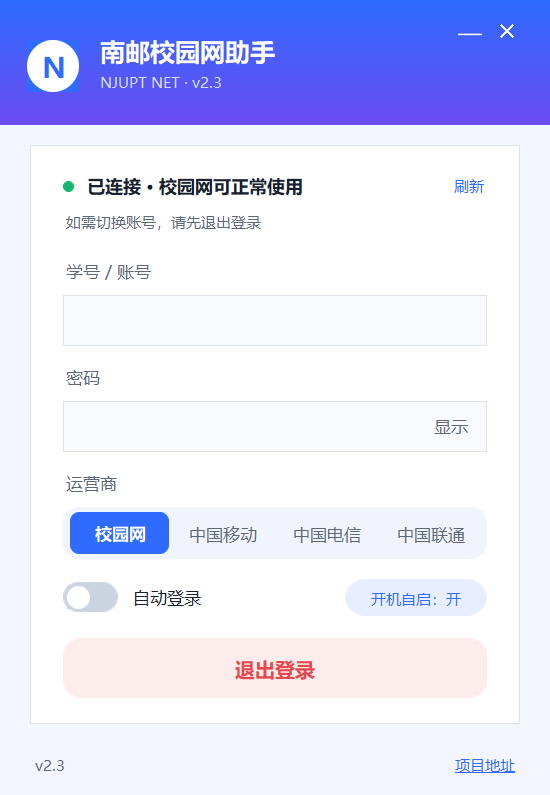
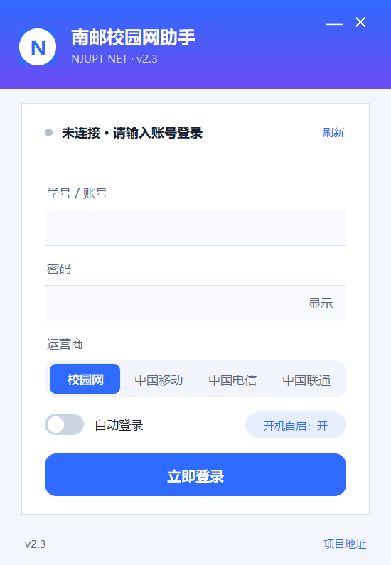

# 🌐 NJUPT 校园网助手 v2.3

> 一个基于 Python + Tkinter 编写的南京邮电大学校园网登录小工具，解决校园网登录繁琐的问题。  
> 打包为 `exe` 文件后，双击即可使用，无需每次打开浏览器手动输入账号密码。

---

## 🆕 v2.3 更新

- 修复认证接口端口变更导致的登录失败：`p.njupt.edu.cn` 的认证接口已由 **804** 改为 **802**（801 为同服务的 HTTP 端口），程序会自动探测可用端口。
- 界面重做：渐变标题栏、卡片式表单、运营商分段选择、密码显示/隐藏、开关式自动登录。
- 单页状态驱动：启动即检测网络状态，同一页面显示“已连接 / 未连接”，主按钮随之在“立即登录 / 退出登录”之间切换。
- 全流程不再弹窗，错误与结果都在状态区就地提示。
- 修复注销失败：注销请求现在会带上本机 IP / MAC / VLAN，否则网关返回“注销操作非本机终端”。
- 开启高 DPI 感知并按系统缩放布局，125% / 150% 缩放下文字不再发虚。
- 圆角、圆形控件改用 4 倍超采样贴图绘制，边缘不再有锯齿。

---

## ✨ 功能特性

- ✅ 支持 **校园网 / 中国移动 / 中国电信** 登录
- ✅ 支持 **自动登录**（保存账号密码，下次自动一键登录）
- ✅ 支持 **开机自启**（自动启动并完成登录）
- ✅ 支持 **一键登出**
- ✅ 配置文件本地保存（`config.bin`），简单安全
- ✅ 打包为 **Windows 可执行文件**，无需额外安装 Python 环境

---

## 📸 软件截图

### v2.3 单页界面


&nbsp;&nbsp;



---

## 🚀 使用方法

1. 前往 [Release 页面](https://github.com/1EM0NS/NJUPT_NET/releases) 下载最新的 `NJUPT_NET.exe`
2. 双击运行程序，输入账号和密码
3. 选择运营商（默认校园网）
4. 可选：
   - 勾选 **自动登录** → 下次自动完成登录
   - 点击 **开机自启** → 开机后自动运行程序并登录
5. 点击 `保存并登录` 即可

---

## ⚙️ 技术细节

- 界面使用 **Tkinter** 自定义标题栏 & 样式
- 网络请求使用 `requests`，直连校园网认证网关（`p.njupt.edu.cn` → `10.10.244.11`）
- 认证接口：`https://p.njupt.edu.cn:802/eportal/portal/{loadConfig,login,logout}`
- 用户配置信息保存于本地 `config.bin` 文件
- 使用 `winreg` 操作注册表实现开机自启
- 支持打包为单个 `exe` 文件（推荐使用 [PyInstaller](https://pyinstaller.org/)）

---

## 📂 项目结构

```bash
NJUPT_NET/
├─ njupt.png        # 程序图标
├─ web2.3.py         # 主程序源码（当前版本）
├─ config.bin       # 本地保存的用户配置（运行后生成）
└─ njupt.ico.exe   #程序图标
```

---

## 🔧 打包方法

本项目推荐使用 **PyInstaller** 打包成单个可执行文件。  

### 安装依赖
```bash
pip install pyinstaller requests pillow pywin32
```

### 打包命令
在项目根目录下执行：
```bash
pyinstaller --name=NJUPT_Net --onefile -w web2.3.py -i njupt.ico --add-data "njupt.png;."
```

参数说明：
- `-F` → 打包为单文件
- `-w` → 去掉命令行窗口（GUI 程序推荐加）
- `-i njupt.png` → 指定程序图标（可选）
- `web2.3.py` → 主程序入口
- `pillow` 用于绘制抗锯齿的圆角控件；缺少时自动回退为纯 Canvas 绘制（边缘会有锯齿）

打包完成后，生成的 `exe` 文件会在 `dist/` 目录下。

---

## 🔒 注意事项

- 本工具仅供南京邮电大学校园网用户使用  
- 账号和密码仅保存在本地，不会上传网络  
- 如遇到登录失败，请检查账号/密码/网络环境是否正确  
- 登录接口依赖校园网认证网关，若校方更新认证系统，可能需要更新程序  

---
---


## 📜 License

MIT License  
你可以自由使用、修改和分发本项目，但请保留原作者信息。
